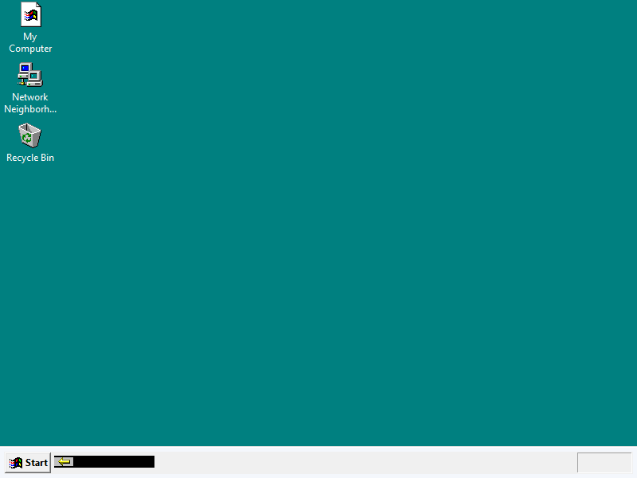
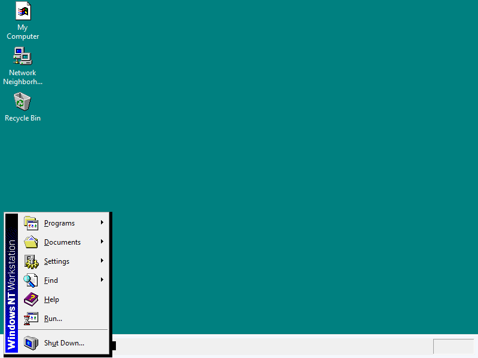
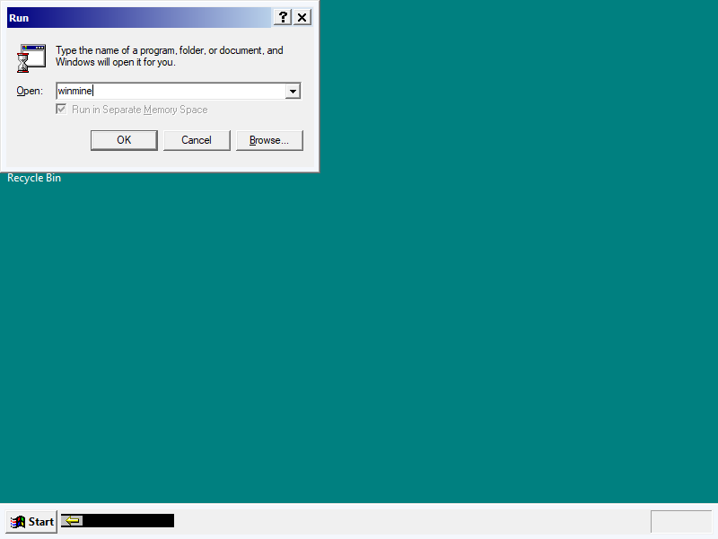
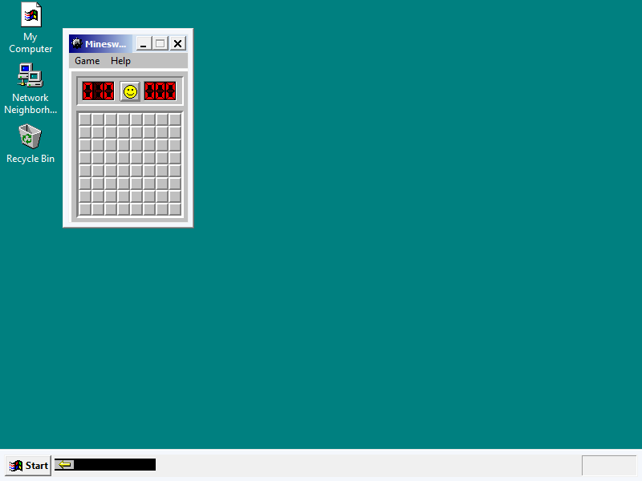

# winnt4-recomp

Windows NT 4.0 Workstation's own userland (Service Pack 6a), statically
recompiled with [pcrecomp](https://github.com/sp00nznet/pcrecomp) and run on a
modern Windows host, with no emulator.

**This repository contains no Windows code or data.** Each user lifts
their own copy of Windows NT 4.0; everything that comes from it (the extracted
files, catalogs and lifted C) goes into the gitignored `work/` and `src/gen/`.



| | |
|---|---|
|  |  |
| NT 4.0's own explorer: desktop and taskbar (Win11 host) | Its Start menu |
|  |  |
| Start → Run | → Minesweeper, NT 4.0's winmine on its own user32 |

Sibling of [win2000](https://github.com/sp00nznet/win2000) and
[winxp](https://github.com/sp00nznet/winxp); the NT 4.0 answers
in pcrecomp are behind `ntguest.h`'s `nt_guest_nt4()`. Notes and layouts:
[docs/survey.md](docs/survey.md).

## Getting Started

You need **your own Windows NT 4.0 Workstation CD image with Service Pack 6a**
(an `.iso` laid out as `ROOT\WNT40WKS\I386` and `ROOT\SVCPACK\WKS_SRV\SP6A_I386.EXE`,
or a folder holding `ROOT`). Nothing from Windows is in this repository or
downloaded for you; everything is extracted, lifted and built on your machine
from your copy.

1. Download this repository (the green **Code** button, then **Download ZIP**)
   and unzip it, or `git clone` it, into a folder with no spaces in its path
   and about 15 GB free.
2. Double-click **`Setup.cmd`** and give it your CD image when it asks (or
   `Setup.cmd -Iso D:\iso\nt4.iso`).
3. Double-click **`Windows NT 4.0 (recomp).cmd`** in that folder: NT 4.0's own
   explorer starts in an 800x600 window of its own, with its desktop, taskbar
   and Start menu; Start → Run → `winmine` (or `notepad`, `calc`) starts the
   lifted accessory inside it.

The setup asks before installing anything it needs (Python 3, pefile and
capstone, Git for Windows, 7-Zip, Visual Studio's C++ Build Tools, CMake,
Ninja, and the pcrecomp toolkit beside this folder, or wherever `PCRECOMP`
points; NT 4.0 needs its `nt4` branch or later). A rerun skips every finished
step (`-Force` redoes them, `-Yes` answers yes to every question). Its log is
`setup.log`. The guest sees only `work\profile` as its drives (its `C:\WINNT\Profiles`),
has a registry box of its own (`HKCU\Software\pcrecomp\nt4`, seeded from NT 4.0's
own setup hives by `tools/hive.py`) and makes no sound.

## Status

**Explorer on Windows 11: runs.** NT 4.0's explorer, shell32, comctl32, user32,
gdi32, kernel32 and ntdll, all lifted (only the host's advapi32 as a proxy):
the teal desktop with My Computer, Network Neighborhood and Recycle Bin, the
taskbar, the Start menu, and Start → Run → winmine starting the lifted
Minesweeper in the same screen. Known gaps: the taskbar's own gray is the
host's 3D face (as in win2000), the clock is empty, the task button is
a black box, My Computer has the generic program icon, ole32 is not lifted
(the first-logon Welcome is refused), the desktop icons under a closed dialog
are not repainted until the next paint.

| Stage | What | State |
|---|---|---|
| 1 | Stock accessories lifted on native32 against the host's DLLs | winmine, notepad, calc run |
| 2 | NT 4.0's own ntdll + kernel32 + msvcrt (+ user32, gdi32, mpr) lifted, started by its own LdrInitializeThunk; cmd.exe on top | `cmd /c ver` prints `Windows NT Version 4.0`; `tools/filebox_check.sh` passes |
| 3 | The accessories on NT 4.0's own user32/gdi32 (+ comctl32, shell32, comdlg32): `build/nt<app>.exe` | winmine (start, click, Intermediate, menu, Custom 20x30) and notepad (start, typed) pixel-identical to stage 1; calc's client identical, its window 4 px smaller (below) |
| 4 | Explorer | desktop, taskbar, Start menu, Run → winmine |

**calc's 4 px.** NT 4.0's user32 sizes a window from the client rectangle
itself (AdjustWindowRectEx, client-side) and knows no padded border, which
Windows Vista added to the frame; the host's user32 (stage 1) adds it. The
client areas match pixel for pixel, so the NT 4.0 build's frame is NT 4.0's
own size, and its goldens are approved as they are.

**winmine's Custom dialog** is larger than stage 1's: NT 4.0's user32 gives
a dialog without DS_3DLOOK the bold system font, as NT 4.0 did.

Regression: `py -3 tools/interact.py` drives the accessories and fails when a
lifted build's shot differs from its stage 1 build's (calc's frame and the
Custom dialog differ by design, above) or from its approved golden for this
display (shots/golden/<display>, hashes in tools/golden.json; approved for
3840x2160@192). `py -3 tools/interact.py --approve [app ...]` after checking
new shots by eye.

## Building by hand

`Setup.cmd` does all of this, in this order (`tools/setup.ps1`):

```
sh tools/fetch_nt4.sh <cd.iso>       # I386 + SP6a into work/sys, the rebased set in work/rebased-shell
py -3 tools/w32k_names.py 'Windows NT 4.0' SP6 > work/names/win32k.txt   # (j00ru's public tables)
sh tools/lift_explorer.sh            # build/ntexplorer.exe
sh tools/lift_accessories.sh winmine notepad calc cmd
sh tools/box.sh                      # the registry box and the profile
sh tools/run_explorer.sh NAME 20     # a run on a private desktop, muted, with a shot (shots/exp)
```

Every run is muted (`PCRECOMP_MUTE=1`), on a private desktop
(`HIDDENRUN_DESKTOP`), and in a file box (`PCRECOMP_FILEBOX`); the launch guard
starts only lifted programs, never an original.

## License

MIT for this repository's own code. Windows NT 4.0 is Microsoft's; bring your own copy.
